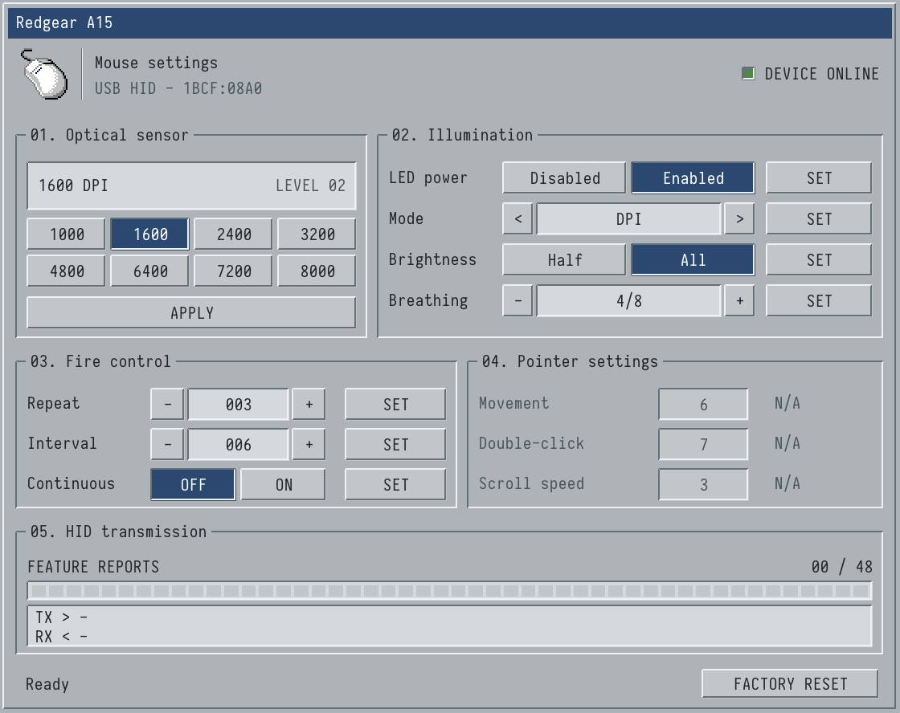

# Redgear-A15

An unofficial Linux configuration utility for the Redgear A-15 gaming mouse, featuring a retro-themed graphical interface built with Rust and Raylib.

> **Note:**
> The Redgear A-15 normally uses:
> - **VID:** `0x1BCF`
> - **PID:** `0x08A0`
>
> If your device uses a *different* VID/PID, you can
> identify the correct values by running:
>
> ```bash
> lsusb
> ```
>
> This will output lines like:
>
> ```
> Bus 001 Device 004: ID 1bcf:08a0 USB Optical Mouse
> ```
>
> Here, `1bcf` is the **VID** and `08a0` is the **PID**.
>
> If your device shows different values, update the corresponding
> VID and PID constants in the source code:
>
> ```rust
> const VID: u16 = 0xXXXX;
> const PID: u16 = 0xYYYY;
> ```
>
> Then rebuild the project:
>
> ```bash
> cargo build --release
> ```

## Disclaimer

This project is an unofficial configuration utility and is **NOT**
affiliated with, endorsed by, or connected to Redgear or its parent
companies in any way.

## Features

Configure your Redgear A-15 mouse directly through a retro-themed
graphical interface.

- **DPI Configuration** — Switch between eight preset DPI levels,
  ranging from 1000 to 8000.
- **LED Control** — Customize RGB lighting modes, brightness,
  breathing speed, and LED status.
- **Fire Control** — Configure auto-fire repeat count, firing
  intervals, and continuous firing.
- **Settings Reset** — Restore mouse settings to their factory defaults.
- **Native Graphical Interface** — A retro-inspired desktop interface
  built using Raylib, without a browser or web-based frontend.

## Screenshot


## Some Notes

During the analysis of the official Windows driver, I observed that
the USB control packets sent for `moving_speed`, `double_click_speed`,
and `rolling_speed` appeared identical regardless of the value
selected in the UI.

This suggests that the official driver may not be sending any actual
instructions to the hardware for these settings, instead relying on
software-side mechanisms or some other undocumented behavior.

The same applies to **Game Mode** and **Office Mode**, for which the
official software did not appear to send any packets to the hardware.

As a result, the following features are currently unsupported:

- Mouse movement speed
- Double-click speed
- Scroll speed
- Game Mode
- Office Mode

I will update the implementation if I find a solution to these
limitations.

## Requirements

- Linux operating system
- Redgear A-15 gaming mouse
- USB access permissions
- Rust toolchain (for building from source)
- CMake and a C/C++ compiler
- System dependencies required by Raylib

## Installation

```bash
# Clone the repository
git clone https://github.com/vamsi200/Redgear-A15.git
cd Redgear-A15

# Build the project
cargo build --release
```

The compiled binary will be available at:

```
target/release/redgear-a15
```

## Usage

Launch the application with root privileges:

```bash
sudo ./target/release/redgear-a15
```

> **Note:** Root privileges are required because the application
> communicates directly with the mouse through USB HID control
> transfers.

## License

This project is licensed under the
[MIT License](https://github.com/vamsi200/Redgear-A15/blob/main/LICENSE).
